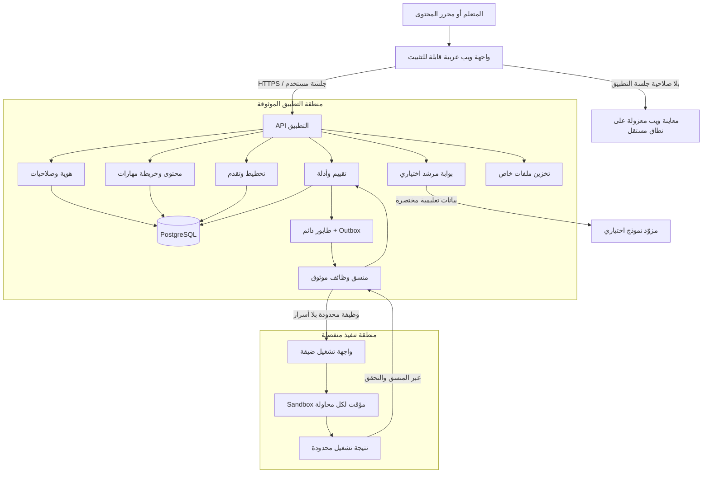
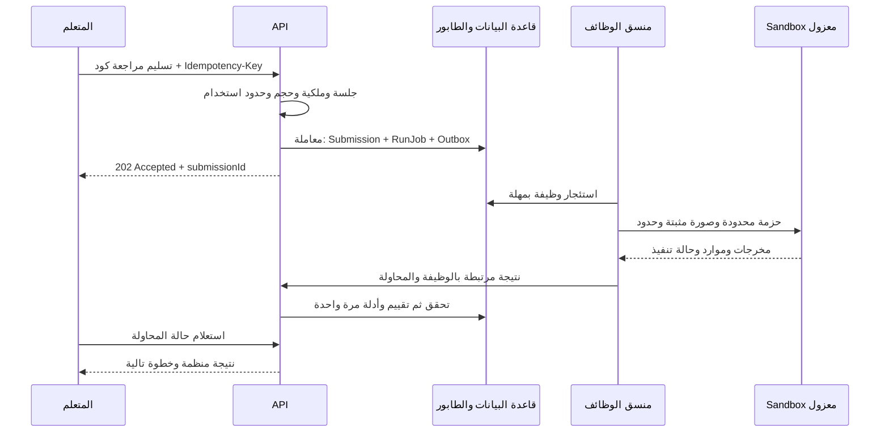

# معمارية NEXORA CODE

NEXORA CODE هو منتج «تعلّم البرمجة بالعربية» في عائلة NEXORA إلى جانب NEXORA-HR وNEXORA-ERP.

**نوع الوثيقة:** تصميم مقترح، لا بنية منفّذة أو نتيجة مراجعة أمنية.  
**النطاق:** تطوير محلي ثم إطلاق تجاري مدفوع على نطاق محدود، يليه توسّع تدريجي متعدد المتعلمين واللغات.  
**مبدأ التصميم:** المحتوى والمهارات والتقييم هي القلب؛ الواجهة والذكاء الاصطناعي وبيئات اللغات تتصل بها عبر حدود واضحة.

**تنفيذ المرحلة الثانية:** واجهة React/TypeScript وASP.NET Core 10 وPostgreSQL موجودة ومختبرة محليًا. نستخدم Npgsql مباشرة مع SQL parametrized وترحيلات بصماتها ثابتة، بدل إضافة EF Core لهذه المرحلة. العقد والتشغيل والأدلة في [phase2/README.md](phase2/README.md). المعمل والمرشد والنشر لاحقة.

## 1. القرار المعماري

نبدأ بـ **Modular Monolith**: تطبيق خلفي واحد، بوحدات مستقلة منطقيًا وعقود واضحة، وقاعدة PostgreSQL واحدة مع ملكية جداول لكل وحدة. نفصل عملية Worker لتنسيق الأعمال الطويلة، ونفصل منطقة تشغيل أكواد المتعلمين أمنيًا وتشغيليًا منذ البداية.

هذا اختيار تصميم لتقليل عبء التشغيل مع الحفاظ على حدود قابلة للفصل لاحقًا. توضح [وثائق Microsoft للمعماريات الشائعة](https://learn.microsoft.com/en-us/dotnet/architecture/modern-web-apps-azure/common-web-application-architectures) إمكانية فصل مسؤوليات التطبيق منطقيًا مع نشر قلبه كوحدة واحدة؛ تقسيمه إلى Microservices مبكرًا ليس شرطًا لهذا المنتج.

وجود خريطة مهارات لا يفرض Graph Database؛ نخزن المهارات وعلاقاتها في PostgreSQL، ونقيّم تعبيرات الشروط داخل محرك المسارات. تدعم PostgreSQL [الاستعلامات التكرارية](https://www.postgresql.org/docs/current/queries-with.html) لتتبع العلاقات؛ قواعد AND/OR واختيار البدائل تبقى منطق تطبيق صريحًا وقابلًا للاختبار.

## 2. التقنيات المقترحة

| الجزء | الاختيار المبدئي | سبب الاختيار أو الحد |
|---|---|---|
| واجهة المتعلم والإدارة | React + TypeScript، وبناء SPA مثل Vite | تفاعل المحرر والخريطة وإعادة استخدام المكونات؛ [توثيق React مع TypeScript](https://react.dev/learn/typescript) |
| التثبيت والاستخدام المحدود بلا اتصال | PWA + Service Worker + IndexedDB | تحميل دروس محددة ومسودات محلية؛ يحتاج تنفيذ سياسة مزامنة صريحة |
| الخادم | ASP.NET Core Web API + C# | منطق المجال والصلاحيات والتقييم وعقود API في تطبيق منظم |
| التعامل مع البيانات | EF Core + PostgreSQL | بيانات علائقية ومعاملات وإصدارات ومراجعة مخطط البيانات |
| الوظائف الخلفية | .NET Worker + طابور مهام دائم في PostgreSQL | فصل طول التشغيل عن طلب HTTP؛ لا الاعتماد على ذاكرة العملية فقط |
| ملفات المحتوى والمشروعات | Object Storage عبر واجهة تخزين؛ تخزين محلي في التطوير | ملفات كبيرة خارج الجداول مع سجل بيانات وصفية وصلاحيات |
| المحرر | مكوّن محرر ويب قابل للاستبدال | يُختبر عربي/إنجليزي ولوحة مفاتيح وموبايل قبل اعتماده؛ تحرير النص العادي بديل للإتاحة |
| تنفيذ الأكواد | Runner على مضيف Linux منفصل، مع gVisor كمرشح عزل أولي | قبول المرشح مشروط باختبار التوافق والعزل لكل صورة لغة |
| البحث | فهرسة داخل PostgreSQL مع تطبيع عربي محدود | قاموس مرادفات ومعرّفات تقنية؛ نختبر جودة البحث قبل محرك إضافي |
| المرشد | واجهة TutorProvider قابلة لتعطيلها أو تبديلها | لا ربط منطق التقدم أو المنهج بمزوّد نموذج بعينه |
| التشغيل والمراقبة | سجلات منظمة + مقاييس وتتبّع عبر OpenTelemetry عند التنفيذ | ربط المحاولة بالوظيفة دون تسجيل أسرار أو كود كامل افتراضيًا |

تُثبت إصدارات مدعومة وتُراجع التراخيص والتبعيات عند التنفيذ. لا توجد حاجة مبدئية إلى Redis أو Kubernetes أو قاعدة متجهات أو Event Bus مستقل؛ تضاف عند وجود حاجة مقاسة. اختيار تقنية بناء المنصة لا يفرض لغة على المتعلم.

## 3. الرسم العام وحدود الثقة



الـ Sandbox لا يتصل بقاعدة الإنتاج أو API الداخلي أو مخزن الأسرار. وسيط التشغيل يتعامل مع هوية آلة محدودة ووظائف مستأجرة، ولا يضع صلاحيات المنسق داخل مساحة الكود المنفذ. التطبيق لا يثق برسالة من المتصفح تقول «الحل صحيح».

## 4. وحدات المجال وملكية المسؤوليات

| الوحدة | تملك | لا تتولى |
|---|---|---|
| Identity | الحساب والجلسة والأدوار والتحقق من ملكية الموارد | تقييم المهارات |
| Catalog & Content | اللغات والتخصصات والدروس والقاموس والإصدارات والنشر | تحديد إتقان المستخدم |
| Skill Graph | المهارات وتعبيرات المتطلبات والتحقق من سلامة الخريطة | توليد شرح حر |
| Planning | الهدف واختيار البدائل والفجوات وترتيب الخطة وأسباب الخطوات | تعديل نتيجة محاولة |
| Assessment | التمرين والـ Rubric والمصحح وأدلة المستوى | تنفيذ الكود داخل API |
| Learning Progress | ملف المهارات والمراجعات واشتقاق الحالة من الأدلة | الاعتماد على مدة التصفح كإتقان |
| Lab | طلبات التشغيل والصور والموارد وحالة الوظائف | منح اعتماد مهني |
| Tutor | شرح وتلميحات وإحالات إلى محتوى منشور | تغيير المنهج أو الصلاحيات أو قرار الإتقان |
| Authoring & Operations | التأليف والمراجعة والنشر وسجل التدقيق وحدود الاستخدام | تجاوز فحوص النشر بصمت |

تتواصل الوحدات بعقود Application Services وأحداث داخلية. لا تكتب وحدة مباشرة في جداول وحدة أخرى. المعاملات القصيرة داخل قاعدة واحدة تكفي للاتساق الأولي، وOutbox يسجل الحدث داخل نفس معاملة التغيير ثم يُسلّم بأمان.

## 5. نموذج خريطة المهارات

### المهارة ليست درسًا ولا لغة كاملة

أمثلة: `concept.conditions` و`concept.functions` و`python.functions.basic` و`js.dom.events` و`http.requests.basic`. يمكن لدرس واحد تعليم أكثر من مهارة، وللمهارة الواحدة أكثر من شرح وتمرين.

يميز السجل بين:

- **Capability level:** عمق القدرة، مثل `basic` أو `applied` أو `independent`، وفق تعريف منشور للمستوى.
- **Learning status:** وضع الدليل والتعلم: `unknown`، `learning`، `practiced`، `demonstrated`، `review_due`.
- **Evidence:** المحاولات والنتائج والمساعدة والإصدار والتاريخ، وهي أصل قرار المستوى والحالة.

`demonstrated` بلا مستوى وسياق لا تكفي لإثبات أي متطلب. `review_due` لا يمحو الدليل القديم؛ يضيف طلب تحديث عندما تشترط سياسة المهارة حداثة الدليل.

قاموس المستويات المشترك بين المنهج والـ API:

| الرمز الثابت | الاسم العربي |
|---|---|
| `orientation` | تمهيدي |
| `basic` | أساسيات |
| `applied` | مطبّق |
| `independent` | مستقل |
| `advanced` | متقدم في تخصص |

ترتيب المستويات يقارن قدرات **المهارة نفسها** وفق وصفها المنشور؛ لا يجعل المستوى المتقدم في Python دليلًا على أساسيات HTTP. ولا يلزم أن تستخدم كل مهارة المستويات الخمسة. حالة التعلم منفصلة عن المستوى، فمثلًا يمكن أن يكون المستوى المثبت `basic` مع طلب مراجعة `review_due`.

### صيغة المتطلبات

تخزن كـ AST ذات schema معروفة في JSONB، مع فهرس روابط مشتق للبحث وكشف الدورات. تكون شروط `required` بوابات، بينما `recommended` و`parallel` روابط إرشادية منفصلة.

```json
{
  "skillId": "api.design.intro",
  "required": {
    "allOf": [
      { "skill": "http.requests.basic", "minLevel": "basic" },
      {
        "anyOf": [
          { "skill": "python.foundations", "minLevel": "basic" },
          { "skill": "csharp.foundations", "minLevel": "basic" },
          { "skill": "javascript.foundations", "minLevel": "basic" }
        ]
      }
    ]
  },
  "recommended": ["git.basics"],
  "parallel": ["testing.introduction"]
}
```

هذا مقرر تصوري متعدد اللغات. درس ASP.NET Core نفسه يحتاج C# ومهاراته، ولا يتحقق بمجرد Python. خيارات OR تكون متكافئة للهدف المعلن فقط. تمنع schema المجموعات الفارغة والمراجع غير الموجودة والتكرار غير المقصود والعمق المفرط.

قبل النشر: تُحل جميع المراجع إلى إصدارات منشورة متوافقة، وتُرفض الدورات في روابط المتطلبات الضرورية الممكنة وفق سياسة DAG محافظة، ويُتحقق من أن كل فرع معروض له محتوى وتقييم مناسب. العلاقات المتوازية لا تدخل في DAG الإلزامية.

## 6. محرك بناء الخطة

الخطة ناتج حتمي قابل للتفسير من `(الهدف، تفضيلات المتعلم، أدلته، إصدار المنهج، إصدار قواعد التخطيط)`؛ لا يولدها النموذج اللغوي بحرية.

1. حل الهدف إلى حزمة مهارات ومستويات ونواتج مشروع محددة.
2. تحميل المتطلبات المنشورة والتحقق من سلامتها وتغطية المحتوى والجهاز وبيئة التنفيذ.
3. احترام القيود الصريحة: اللغة المختارة والهدف. داخل ANY_OF يرشح البدائل المتوافقة، ويقارن الفجوات والجهد والتوفر، مع كسر تعادل ثابت وتسجيل السبب.
4. إذا تعددت البدائل المناسبة تعرض للمستخدم؛ لا ادعاء بحساب أقصر مسار عالمي مع تعبيرات منطقية معقدة. البداية سياسة ترتيب قابلة للاختبار والتحسين.
5. مقارنة كل متطلب بالدليل والمستوى والسياق والحداثة؛ المعرفة المصرح بها توجّه التشخيص ولا تمنح تجاوزًا معتمدًا وحدها.
6. تكوين subgraph بعد تثبيت البدائل، وحذف الخطوات المتحققة فقط، وترتيب الباقي طوبولوجيًا.
7. إرفاق كل خطوة بـ `reasonCode` وسبب عربي، والمتطلب الذي تفتحه، وأصل إضافتها، وبديلها إن وجد.
8. توزيع الوحدات والمشروعات والمراجعات على جلسات تناسب الوقت المتاح؛ عرض نطاق جهد دون ضمان موعد احتراف.
9. حفظ نسخة الخطة والقرارات، ثم تحديث الخطوة التالية عند وصول دليل جديد. تغيير الهدف أو إصدار المنهج ينتج معاينة فروق قبل اعتماد خطة بديلة.

سياسة الاقتراح: يختار من الخطوات الجاهزة ما يخدم الهدف الأقرب مع معالجة فجوة معيقة. التعثر يولّد تدريبًا محددًا أو تشخيصًا لمتطلب سابق؛ لا يعيد دورة كاملة تلقائيًا.

إذا غاب المحتوى أو runtime، تكون نتيجة التخطيط `partial` أو `unavailable` مع قائمة نقص واضحة؛ لا ننتج «مسارًا كاملًا» بروابط فارغة. يسمح الاستكشاف بمعاينة دروس متقدمة، لكن اعتماد مستواها يتبع شروط التقييم والمتطلبات المعلنة.

## 7. الإتقان والتقييم

سياسة التقييم تصدر مع المهارة وتحدد نوع الدليل والحد المطلوب. مثال أولي قابل للمعايرة: فهم المفهوم، ومهمة جديدة مستقلة تمر باختبارات السلوك، وشرح أو تعديل صغير للتأكد من قابلية النقل. ليس هذا شرطًا رقميًا موحدًا لكل مهارة.

- مشاهدة الدرس أو تشغيل مثال ينقل إلى التعلم/الممارسة، ولا يكفي لـ `demonstrated`.
- التلميحات والحل المعروض تحفظ ضمن evidence؛ تُستخدم مهمة جديدة مستقلة للاعتماد المناسب.
- نجاح اختبارات سلوك لا يثبت وحده جودة التصميم أو أمانه أو الإتاحة أو الجاهزية المهنية.
- المشروعات تستخدم Rubric، مع مراجع بشري عندما لا يكون الحكم الآلي موثوقًا؛ إن غاب المراجع تبقى تلك الأبعاد «غير مقيّمة».
- دلالة الاختبارات على المهارة تُراجع؛ لا تُحسب كل المهارات المرتبطة بدرس بسبب نجاح تمرين لا يقيسها.
- نقل المفهوم بين اللغات مسموح بدليله؛ مهارات الصياغة والأدوات للغة الجديدة تحتاج تحققًا ملائمًا.
- لا يسحب تحديث المحتوى اعتمادًا بصمت. يحتفظ بالدليل والإصدار، ويطلب bridge assessment إذا تغيرت المتطلبات فعلًا.

يصدر قرار التقييم من خادم موثوق وسياسة ذات إصدار. نتيجة المعمل مدخل للقرار؛ نص stdout أو رسالة المتعلم أو إجابة المرشد لا تمنح درجة مباشرة.

## 8. نموذج البيانات المقترح

هذه كيانات منطقية؛ تقسيمها إلى جداول نهائية وقيود SQL يتم في أول migration:

| المجموعة | الكيانات والحقول المركزية |
|---|---|
| الهوية | `User`، `Role`، `Session`، `LearnerProfile`، الوقت الأسبوعي والجهاز وتفضيل الهدف |
| الكتالوج | `Technology(type)`، `Track`، `TrackVersion`، `GoalTemplate`، `CurriculumRelease`، حالة التغطية |
| المهارات | `Skill(stableId)`، `SkillVersion`، `RequirementExpression`، `RequirementReference`، تعريف المستويات |
| المحتوى | `Lesson`، `LessonVersion`، `LessonSkill`، `GlossaryTerm`، `Asset`، اللغة وحالة النشر والمراجع |
| التقييم | `ExerciseVersion`، `TestSuiteVersion`، `RubricVersion`، `AssessmentCriterion`، `CriterionSkillMapping`، `AssessmentPolicyVersion`، `RuntimeProfile` |
| الخطة | `LearningPlan`، `PlanRevision`، `PlanStep`، البدائل والأسباب وإصدار المنهج والتخطيط |
| العمل | `Workspace`، `DraftRevision`، `Submission`، `SourceBundle`، `RunJob`، `RunResult` |
| الأدلة | `Evidence`، `SkillAttainment`، `ReviewSchedule`، مصدر التقييم والمساعدة والإصدار |
| التشغيل | `OutboxEvent`، `JobLease`، `AuditEvent`، `UsageBudget`، حالات التنبيه |

قيود مهمة:

- كل تسليم مرتبط بمراجعة كود غير قابلة للتغيير وبصمة محتوى، وتمرين ومصحح وruntime محددين.
- كل دليل مرتبط بمتعلم ومحاولة وسياسة. قيد فريد يمنع احتساب النتيجة نفسها مرتين.
- `SkillAttainment` عرض مشتق يمكن إعادة بنائه من الأدلة؛ لا عمود نسبة غامضة يكتب فيه عدة مكونات.
- ملفات المتعلم خاصة؛ الوصول بتحقق ملكية وروابط قصيرة الصلاحية عند الحاجة. لا تخزين token مزوّد AI في محتوى الدرس أو قاعدة العميل.
- JSONB للتعبيرات المرنة فقط؛ هوية المستخدم والعلاقات الأساسية وحالات الوظائف بقيود علائقية وفهارس مناسبة.
- تاريخ التشغيل UTC داخليًا؛ عرض الوقت حسب منطقة المستخدم، دون بناء قواعد الاستحقاق على ساعة جهازه وحدها.

## 9. دورة تشغيل محاولة



Polling يكفي أولًا؛ يمكن إضافة SSE عند الحاجة. لا نُبقي طلب HTTP مفتوحًا طوال تشغيل الطالب. الحالة المقترحة:

`queued → leased → running → completed | execution_error | limit_exceeded | infrastructure_error | cancelled`.

ثم يُحفظ **حكم التقييم** منفصلًا: `not_evaluated | passed | needs_work | manual_review`. `completed` تعني انتهاء العملية، ولا تعني نجاح الحل. تجاوز حدود التمرين بسبب كود المتعلم يختلف عن انقطاع مضيف التشغيل.

الطابور دائم بـ lease وheartbeat ومحاولات محدودة وdead-letter. إعادة التسليم متوقعة؛ نستخدم idempotency ومعاملات بدل ادعاء exactly-once. عند انتهاء lease أو إعادة المحاولة، يُرفض قبول نتيجة متأخرة من تنفيذ سابق عبر attempt token. لا يُعاد تشغيل كل خطأ طالب كأنه عطل بنية.

## 10. تشغيل الأكواد غير الموثوقة

### شروط المعمل قبل الإطلاق

- مضيف تشغيل منفصل عن API والبيانات، وشبكة ممنوعة افتراضيًا داخل المهمة.
- مستخدم دون root، وصلاحيات وإمكانات محدودة، ونظام ملفات أساسي للقراءة، ومساحة مؤقتة لكل مهمة.
- حدود CPU ووقت فعلي وذاكرة وعمليات وملفات وحجم إدخال/إخراج، مع إلغاء وتنظيف آلي.
- صور لغات مثبتة بالبصمة، بلا تنزيل حزم عشوائي أثناء المحاولة؛ إضافة المكتبات عبر build مُراجع.
- لا Docker socket أو host mount أو بيانات إنتاج أو credentials داخل بيئة المتعلم.
- قناة نتيجة ضيقة ذات schema، مع التحقق من الوظيفة والهوية والحجم؛ escape لكل المخرجات قبل عرضها.
- عزل بين المحاولات، واختبارات للتسريب والعمليات المتروكة والضغط قبل تمكين كل runtime.

gVisor مرشح لإضافة دفاع في تشغيل الكود غير الموثوق، ويؤكد [نموذجه الأمني](https://gvisor.dev/docs/architecture_guide/security/) أن العزل لا يستبدل المعمارية الآمنة. لا تعتبر هذه الخطة أو استخدام Container إثباتًا لاجتياز الأمان. يمكن تقييم microVM بدلًا منه إذا تطلب نموذج المخاطر أو توافق اللغة ذلك.

أول profiles: Python console، وJavaScript لتحديات منطقية، وheadless browser لتقييم سلوك واجهات الويب. HTML/CSS لهما معاينة وفحوص مناسبة؛ ليسا عملية console. SQL لاحقًا يحتاج قاعدة تمرين مؤقتة لا قاعدة التطبيق. تمارين الشبكات والخدمات اللاحقة تستخدم شبكة مختبر مستقلة بمرافق تجريبية محددة.

**التصحيح والاختبارات المخفية:** تُقارن المخرجات والقيود في مكوّن موثوق خارج كود الطالب حيث يمكن. لا نفترض سرية اختبار يوضع داخل نفس مساحة تنفيذ الكود؛ نسميه «غير معروض في الواجهة» فقط. تقييم جودة HTML/CSS لا يختزل في screenshot أو وجود نص معين؛ يحتاج Rubric ومعايير سلوك وإتاحة ومراجعة عند اللزوم.

### معاينة الويب

نطاق مستقل دون cookies التطبيق، وiframe مع sandbox محدود وCSP تمنع الاتصال والتنقل والنوافذ حسب التمرين، والتحقق من مصدر وقالب أي postMessage. لا تمرر الجلسة أو صلاحية API إلى المعاينة. الإرسال من إطار opaque origin يحتاج تحقق `event.source` ورمز قناة خاص، ولا يعتمد على `event.origin` وحده.

توضح [مواصفة HTML للـ iframe](https://html.spec.whatwg.org/multipage/iframe-embed-object.html) أثر صلاحيات sandbox؛ اختيارها يحتاج اختبارًا، خصوصًا `allow-scripts` و`allow-same-origin`. معاينة المتصفح ليست بديلًا لتقييم موثوق ولا حدًا كافيًا لحماية الصفحة من حلقة JavaScript لا تنتهي؛ زر الإيقاف وحده ليس ضمانًا.

**بوابة تمكين JS المحلي:** تبقى معاينة JavaScript على جهاز المتعلم معطّلة، يدويًا وتلقائيًا، حتى تُثبت استجابة الصفحة وآلية القطع والعزل في المتصفحات المدعومة. عند عدم تحقق ذلك، تتاح معاينة HTML/CSS دون scripts، وتعمل JS وتقييمات التفاعل داخل متصفح headless في المعمل البعيد بوقت محدود وwatchdog خارجي، وتُعاد النتائج والمخرجات ولقطات غير منفذة. المعاينة الحية التفاعلية تحتاج آلية عزل بديلة مجرّبة؛ لا يُقدّم نموذج محلي غير قابل للقطع على أنه آمن. تظل وظيفة بناء موقع تفاعلي قابلة للتقييم عبر سيناريوهات تفاعل المعمل.

## 11. المرشد الذكي وحدوده

`TutorProvider` يستقبل السؤال، وناتج الدرس وإصداره، ومقتطف الكود الذي اختار المتعلم مشاركته، ورسالة الخطأ المناسبة. يبحث أولًا في المحتوى المنشور وقاموس المصطلحات؛ تعاد مراجع الدروس المستخدمة أو عبارة واضحة عند غياب سند كافٍ.

- لا يكتب مباشرة في جداول المهارات أو الدرجات أو المنهج.
- لا يملك shell ولا credentials للبيانات أو حق نشر المحتوى أو تشغيل أوامر خارج معمل مضبوط.
- يعامل الكود والتعليقات والمستندات المسترجعة كبيانات قد تحتوي تعليمات مضللة.
- لا يرسل محتوى حساب كاملًا أو بيانات شخصية أو مفاتيح؛ أسرار الخادم تبقى خارج الطلبات.
- سقوف استخدام لكل مستخدم وجلسة، ومهلة وتعطيل تلقائي عند بلوغ الميزانية.
- تلميحات مُراجعة وشرح أساسي متاحان دون AI؛ لا يتوقف تقدم المتعلم عند تعطله.
- اقتراح سؤال أو تقييم حر لا يصبح منشورًا أو معتمدًا حتى يمر بمراجعة المحتوى وسياسة التقييم.

لا حاجة أولًا إلى Vector Database؛ نبدأ باسترجاع الدرس الحالي ومراجع المهارات وبحث مفهرس. تقيّم جودة العربية وصحة الإحالات والتعامل مع «لا أعلم» في مجموعة أسئلة مُراجعة قبل إطلاق المرشد.

## 12. إصدارات المحتوى والمنهج

لكل مهارة معرّف ثابت وإصدارات، ولكل درس وتمرين ومصحح ومسار إصدار. يجمع `CurriculumRelease` نسخًا متوافقة منشورة؛ ترتبط خطة المتعلم بإصدار معروف.

دورة النشر: `draft → technical_review → learning_review → published → retired`. النشر يتطلب فحص روابط الخريطة وتشغيل الأمثلة والاختبارات والتحقق من إتاحة جميع ملفات النسخة. إصلاح تمرين معيب يُنتج إصدارًا ومراجعة للأدلة المتأثرة، دون اتهام المتعلم أو محو سجله.

عرض المحتوى حد ثقة مستقل: renderer لصيغة Markdown محدودة، مع منع HTML الخام افتراضيًا. أي استثناء يمر بتعقيم بقائمة سماح تمنع scripts وevent handlers وروابط البروتوكولات الخطرة؛ أمثلة الكود تُعرض كنص مُرمّز، وSVG المرفوع لا يُدرج مباشرة داخل صفحة التطبيق. تُفحص الملفات وأسماؤها وأنواعها وأحجامها، وتقدم المرفقات بصلاحيات وسياسة عرض مناسبة. مراجعة المؤلف لا تغني عن هذه الضوابط؛ تفصل [إرشادات OWASP لمنع XSS](https://cheatsheetseries.owasp.org/cheatsheets/Cross_Site_Scripting_Prevention_Cheat_Sheet.html) بين ترميز النص وتعقيم HTML حسب سياق العرض.

عند ترحيل خطة: نعرض الجديد والمحذوف والتبديل، ونحافظ على سجل المراجعات، ونضيف اختبار جسر عند تغير المهارة. تجميد الإصدارات لا يمنع معالجة خطر أمني؛ أي إيقاف اضطراري يظهر بسبب وخيار متابعة بديل.

## 13. عقود API أولية

الأسماء أمثلة لتوضيح الحدود؛ تُثبت عبر OpenAPI عند التنفيذ:

| العقد | الغرض |
|---|---|
| `GET /api/v1/catalog?status=published` | كتالوج متاح بالفعل؛ قسم منفصل للمخطط |
| `POST /api/v1/diagnostics` | إنشاء تشخيص مناسب للهدف دون اعتماد ذاتي |
| `POST /api/v1/plan-previews` | هدف وتفضيلات → خطة مفسرة أو فجوات تغطية |
| `POST /api/v1/learning-plans` | اعتماد معاينة مرتبطة بإصدارات معلومة |
| `POST /api/v1/learning-plans/{id}/revisions` | اعتماد تغيير هدف أو إصدار مع حفظ السابق |
| `GET /api/v1/me/next-step` | الدرس أو المراجعة المقترحة وسببها |
| `PUT /api/v1/workspaces/{id}/draft` | حفظ مسودة مع ETag لاكتشاف التعارض |
| `POST /api/v1/submissions` | محاولة immutable + مفتاح منع التكرار؛ يعود 202 |
| `GET /api/v1/submissions/{id}` | حالة التشغيل وحكم التقييم ومراجعة الكود |
| `GET /api/v1/me/skills` | مستويات وأدلة وحالات مراجعة، لا أسرار المصحح |
| `POST /api/v1/tutor/hints` | طلب تلميح محدود وبسند محتوى عند توفره |
| `POST /api/v1/authoring/releases/{id}/publish` | نشر بعد الصلاحية وفحوص الإصدار وسجل تدقيق |

يتحقق الخادم من الملكية لكل مورد. جلسات HttpOnly/Secure مع حماية CSRF للطلبات المعدِّلة، وصلاحيات مؤلف/مراجع/مدير منفصلة عن المتعلم. لا يؤخذ `userId` من الطلب كدليل ملكية، ولا تخزن جلسة الدخول في localStorage.

### استحقاق الوصول التجاري

الحساب والجلسة يحددان هوية المتعلم، ويحدد استحقاق الوصول بصورة مستقلة المحتوى والخصائص المدفوعة المتاحة له. يتحقق الخادم من الاستحقاق عند كل طلب لمورد مدفوع، بما في ذلك الوصول المباشر وإصدار روابط ملفات المحتوى. تعكس الواجهة قرار الخادم.

يُنفَّذ الدفع والتحقق من الاستحقاق في مرحلة تطوير تسبق الإطلاق التجاري. يُمنح الوصول بعد تأكيد الدفع وفق الطريقة المعتمدة، وتتبع معالجة غياب الاستحقاق أو انتهائه سياسة العرض المقررة. سعر الوصول وطريقة الدفع وإتاحة تجربة أو محتوى مجاني قرارات مفتوحة. تُستخدم العينة المحلية للتطوير.

## 14. العربية والإتاحة والعمل بلا اتصال

الوثيقة `lang="ar" dir="rtl"`، والكود ومخرجاته `dir="ltr"` مع عزل الأسماء التقنية المضمنة بحسب السياق؛ [إرشادات W3C للاتجاه](https://www.w3.org/International/questions/qa-html-dir) توصي بالاتجاه البنيوي عبر `dir` والخصائص المنطقية للتخطيط.

لا نغير ترتيب حروف الكود لتجميل عرضه، ونبرز محارف التحكم الاتجاهية المريبة بدل إخفائها. البحث العربي يطبع النص للفهرسة فقط دون تغيير النص الأصلي أو الكود. الـ URLs والمعرّفات مستقرة حتى لو تغير عنوان الدرس.

بلا اتصال: دروس اختار المستخدم تنزيلها ومسودات محلية على جهازه، وحالة مزامنة ظاهرة. لا تشغيل خادم أو اعتماد نهائي جديد حتى عودة الاتصال. يتم فصل بيانات التخزين بحسب الحساب، مع مسح/إدارة البيانات على الجهاز المشترك، ونسخ تعارضات المسودات بدل الكتابة فوقها.

يخضع تنزيل الدروس المدفوعة لسياسة الوصول المعتمدة، ويتحقق الخادم من الاستحقاق عند إصدار التنزيل.

الاختبار المطلوب يتضمن لوحة المفاتيح وقارئ الشاشة والتكبير واتجاه النص المختلط. لا يُعلن التوافق مع معيار إتاحة بناءً على الاختيار التقني وحده. تفاصيل الشاشات في [UX_SPEC.md](UX_SPEC.md).

## 15. النشر والتشغيل والتوسّع

في التطوير: واجهة وAPI وPostgreSQL محلي، مع Runner مُحاكى لا يقيّم كودًا فعليًا، أو معمل تطوير معزول مستقل. لا نغير خدمات الجهاز أو نثبت أدوات ضمن إعداد التصميم.

في الإطلاق المحدود: HTTPS/reverse proxy، وAPI وWorker موثوقان، وPostgreSQL وتخزين خاص ونسخ احتياطية، ومضيف Linux منفصل للمعمل. يمنع الوصول المباشر العام إلى البيانات أو وسيط التشغيل. حفظ صور التنفيذ وتحديثها جزء من التشغيل.

تُجرّب استعادة النسخ الاحتياطية، وتفصل بيانات التطوير والتجربة والإنتاج، وتُدار الأسرار خارج Git. الهجرة للبيانات مُراجعة مع نسخة احتياطية وخطة تراجع مناسبة، والتطبيق يسجل correlation IDs للمحاولة والوظيفة. لا تُسجل الشيفرة أو نص جلسة المرشد كاملًا افتراضيًا.

التوسع الأول يزيد عدد slots المعمل وفق ميزانية وحدود متعلم عادلة، ثم نسخ API عند الحاجة. نضيف queue مستقلة أو cache عند قياس الضغط. نفصل وحدة كخدمة عند الحاجة إلى نشر أو ملكية أو توسع مستقل مثبت، مع الحفاظ على outbox وعقود البيانات.

الأداء يختبر بمزيج واقعي: قراءة دروس، حفظ مسودات، إنشاء خطط، تشغيل أكواد. تُحدد أحمال القبول وعدد المستخدمين المتزامنين بعد تحديد السعة والميزانية؛ لا يَعِد الرسم بسعة آلاف أو ملايين المستخدمين.

## 16. التحقق المطلوب قبل التنفيذ العام

| المجال | تحقق ذو معنى |
|---|---|
| الخريطة | AND وOR متداخلتان، فروع غير متاحة، مراجع مفقودة، دورة، ومستوى غير كافٍ |
| التخطيط | هدفان مختلفان، احترام اللغة، نقل مفهوم دون syntax، تعادل البدائل، تغيير الإصدار |
| الأدلة | مساعدة ثم تحقق مستقل، تكرار نتيجة، نتيجة قديمة، وإعادة بناء ملف المهارات |
| الطابور | سقوط Worker وإعادة lease، مهلة، تكرار تسليم، وإيقاف وظيفة دون فقد محاولة |
| المعمل | حلقة لا تنتهي، استهلاك ذاكرة وعمليات، محاولة شبكة/ملفات، عزل محاولتين، تنظيف |
| الويب | فصل المعاينة والجلسة، رسائل postMessage مضللة، فشل headless، وسلامة عرض المخرجات |
| الهوية | وصول أفقي لمحاولة ومسودة مستخدم آخر، صلاحيات نشر، CSRF وحدود الاستخدام |
| الوصول التجاري | تأكيد الدفع بالطريقة المعتمدة، فتح المورد للحساب المستحق، ورفض طلبه المباشر من حساب بلا استحقاق |
| المحتوى | كل مثال يعمل بإصداره وكل تمرين يقيس مهارته وRubric لا يدّعي حكمًا غير منفذ |
| المرشد | تلميح صحيح بسند، نقص سند، prompt injection، تعطل المزوّد وحدود التكلفة |
| التجربة | مبتدئ يفهم سبب الخطوة، RTL/LTR، حفظ واستئناف وتعارض، وإتاحة الإجراءات الأساسية |
| التشغيل | استعادة نسخة احتياطية، نشر نسخة محتوى، تعطيل runtime مع بديل، ومراقبة عطل دون كشف أسرار |

هذه قائمة قبول مستقبلية. **لم تُنفذ هذه الفحوص أو تُختبر قاعدة بيانات أو Sandbox ضمن إعداد هذه الوثائق.**

## 17. سجل القرارات المختصر

| القرار | المعتمد للتصميم | متى نراجعه؟ |
|---|---|---|
| ADR-01 | ويب متجاوب/PWA أولًا | حاجة أصلية للجهاز أو تشغيل محلي كامل |
| ADR-02 | Modular Monolith مع فصل المعمل | توسع أو استقلال نشر مثبت لوحدة |
| ADR-03 | PostgreSQL للبيانات والخريطة والطابور الأولي | ضغط أو استعلامات لا تعالجها البنية بكلفة معقولة |
| ADR-04 | المهارة والأدلة أساس التقدم | مراجعة تربوية لتحديد مستويات أو دليل أدق |
| ADR-05 | قواعد حتمية للخطة والتقييم وAI اختياري | أي إضافة لا تلغي التفسير والتحقق المستقل |
| ADR-06 | gVisor مرشح لا قرار أمان نهائي | نموذج التهديد واختبارات التوافق والعزل |
| ADR-07 | لا فيديو ولا تطبيقات أصلية ولا خدمات إضافية لازمة للإطلاق | نتائج تجربة المتعلم والميزانية |

## 18. بنية مستودع مستقبلية

```text
apps/
  web/                     # واجهة المتعلم والتأليف
src/
  Learning.Api/            # HTTP والجلسة والتركيب
  Learning.Modules/        # وحدات المجال بعقود واضحة
  Learning.Worker/         # outbox والوظائف والمراجعات
  Learning.Contracts/      # عقود الإصدار والرسائل
lab/
  broker/                  # واجهة تشغيل محدودة في منطقة المعمل
  runtimes/                # صور وإعدادات إصدارات اللغات
  graders/                 # مصححات موثوقة ونسخ اختبارات
content/
  ar/                      # مصادر محتوى تخضع للمراجعة
tests/                     # اختبارات مجال وتكامل وعزل وتجربة
ops/                       # نشر ومراقبة واستعادة
docs/                      # قرارات المعمارية ومواصفات المحتوى
```

هذه بنية المنتج المستقبلي. نُفّذت عينة مستقلة في `phase1/`، ثم أساس الخادم والواجهة والبيانات في `phase2/`. راجع [PROJECT_STATUS.md](PROJECT_STATUS.md) للتمييز بين المنفذ والمقترح.
