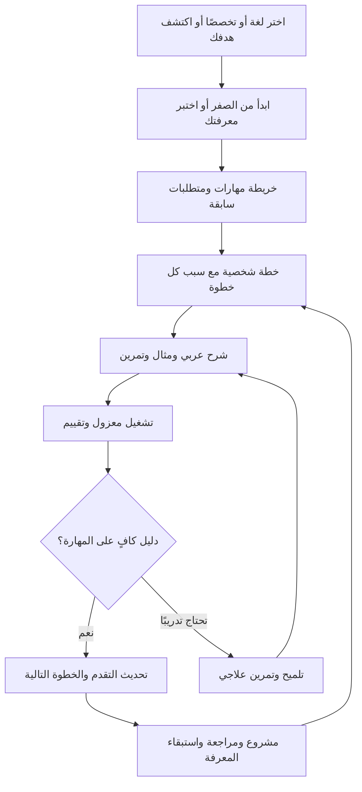

# NEXORA CODE — تعلّم البرمجة بالعربية

**الحالة** — النسخة التجارية هي بيئة التشغيل المعتمدة لـ NEXORA CODE، ومنها تُدار التحديثات والمستخدمون والمحتوى. [رابط النسخة التجارية](https://desktop-phkhegp.tail3372f6.ts.net:10000/nexora-commercial/#start) · [حالة المشروع](PROJECT_STATUS.md)
**تاريخ التصميم:** 10 نوفمبر 2026.  
**المنتج:** منصة تعليمية مدفوعة ضمن عائلة NEXORA، إلى جانب NEXORA-HR وNEXORA-ERP.

المنتج يرشد المتعلّم من نقطة معرفته الحالية إلى هدف محدد، بلغة عربية واضحة، ويحسب المتطلبات السابقة ويقيس التقدم بأعمال يمكن التحقق منها. يستطيع المتعلم البدء بلغة، أو بتخصص، أو برحلة لاكتشاف ما يناسبه.

رؤية المنتج هي استيعاب لغات وتخصصات متعددة تدريجيًا عبر كتالوج قابل للتوسّع. الاحتراف يُقاس بقدرة عملية داخل تخصص ومستوى محددين؛ لا توجد نهاية واقعية اسمها «إتقان جميع لغات البرمجة» أو وعد زمني يصلح للجميع.

## ملفات التصميم

ابدأ بحالة التنفيذ في [PROJECT_STATUS.md](PROJECT_STATUS.md)، وتشغيل التطبيق في [دليل النسخة التجارية](phase6/README.md)، والمنهج المنشور في [دليل المرحلة الحادية عشرة](phase11/README.md)، الذي يضيف الخوارزميات وهياكل البيانات وتصميم الكائنات بـPython وتحديات حل المشكلات. يضم الإصدار التجاري `phase11-ar-v1` 110 دروس و304 تمارين مصححة و18 هدفًا و46 مختبر كونسول. العينة الأصلية في [phase1/README.md](phase1/README.md).

| الملف | ما يوضحه |
|---|---|
| [PRODUCT_PLAN.md](PRODUCT_PLAN.md) | فكرة المنتج، نطاق الإطلاق، الخصائص، مراحل التنفيذ ومعايير القبول |
| [ARCHITECTURE.md](ARCHITECTURE.md) | المكونات، خريطة المهارات، نموذج البيانات، تدفق التشغيل والعزل والقرارات التقنية |
| [CURRICULUM.md](CURRICULUM.md) | الأساسيات، اللغات والتخصصات، المتطلبات السابقة، أمثلة الخطط وقواعد الإتقان |
| [UX_SPEC.md](UX_SPEC.md) | رحلة المستخدم والشاشات وسلوك الواجهة العربية وحالات الخطأ |
| [هوية NEXORA CODE](docs/brand-guidelines.md) | الاسم والشعار والألوان وإرشادات استخدام الحزمة |

## القرارات الأساسية

1. البداية تطبيق ويب متجاوب قابل للتثبيت كـ PWA؛ يمكن إضافة عميل سطح مكتب أو موبايل لاحقًا.
2. الواجهة والشرح والإرشاد بالعربية؛ الكود والكلمات المحجوزة وأسماء الأدوات بصيغتها الأصلية، مع شرح عربي.
3. المهارات والمفاهيم هي أساس المنهج، واللغات والتخصصات أهداف تجمع هذه المهارات.
4. محرك قواعد موثوق يبني المسار ويقيّم الأدلة؛ المرشد الذكي إضافة اختيارية للشرح والتلميحات.
5. التطبيق الأساسي واحد مقسّم إلى وحدات؛ بيئة تشغيل أكواد المتعلمين منفصلة عنه.
6. الإطلاق: أساسيات مشتركة + Python/الأتمتة + مدخل تطوير الويب بـ HTML/CSS/JavaScript.
7. نُشر توسع المرحلة الحادية عشرة للخوارزميات وتصميم الكائنات وحل المشكلات، بعد مسارات JavaScript للمشروعات وReact وTypeScript. يحسب كل هدف متطلباته السابقة ويعيد استخدام المهارات المثبتة.
8. الوصول للمحتوى المدفوع في الإصدار التجاري يتطلب صلاحية وصول يتحقق منها الخادم. السعر وطريقة الدفع وإتاحة أي معاينة عامة قرارات مؤجلة.

## الصورة العامة

## طريقة استخدام الخطة

ابدأ بملف المنتج، ثم المنهج، ثم المعمارية وتجربة الاستخدام. أول خطوة تنفيذية هي اعتماد عينة محتوى صغيرة وتجربة رحلة التعلّم كاملة، قبل توسيع عدد اللغات. أعداد الدروس والمراحل الواردة أهداف تخطيطية وليست محتوى مُنتجًا أو تقديرًا تعاقديًا.

تتضمن الحزمة العينة الأصلية وتطبيق المرحلة الثانية بحسابات وبيانات وتقدم وإصدارات محتوى محلية. Sandbox وتشغيل أكواد المتعلم من عمل المرحلة الثالثة. الاختبارات التقنية لا تحل محل تجربة مبتدئ بشري.
