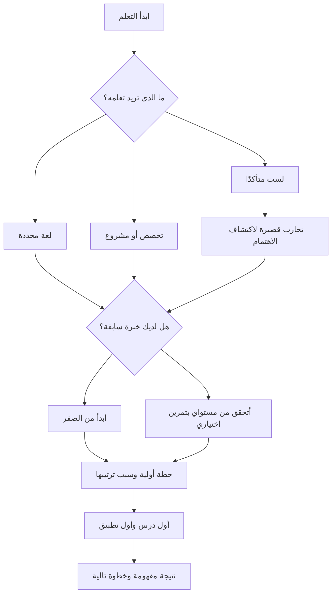

# تصميم تجربة استخدام NEXORA CODE

هذا مستند مقترح لتجربة المنتج، وليس واجهة منفذة أو نتائج اختبار مستخدمين. تتفق نسخة الإطلاق المقترحة مع نطاق: أساسيات البرمجة، وPython للأتمتة، وأساسيات الويب HTML/CSS/JavaScript. يظهر React وباقي التخصصات في خطة التوسع بحالة واضحة، ولا يظهر مسار غير منشور كأنه متاح للتعلم.

## 1. الوعد الذي تفهمه من الشاشة الأولى

تظهر علامة **NEXORA CODE** مع الوصف **«تعلّم البرمجة بالعربية»**. تنتمي المنصة إلى عائلة NEXORA إلى جانب NEXORA-HR وNEXORA-ERP. تستخدم شاشات البداية والحساب والدروس والتنقّل الشعار والألوان المحددة في [دليل الهوية](docs/brand-guidelines.md).

«اختر ما تريد أن تبنيه، أو اللغة التي تريد تعلمها، وسنرشدك من مستواك الحالي إلى الخطوة التالية، مع شرح ما تحتاجه قبلها».

لا يحتاج المبتدئ إلى معرفة اسم لغة أو تخصص كي يبدأ. لا يُشترط تعلم الإنجليزية مسبقًا؛ تظهر المصطلحات العربية مع الاسم التقني عند الحاجة، وتبقى الكلمات المحجوزة وأسماء اللغات والمكتبات ورسائل الخطأ الأصلية كما هي مع شرح عربي.

تستخدم الواجهة العربية المبسطة وتشرح المصطلح قبل الاعتماد عليه. تقول «ما الذي ستتعلمه؟» بدلًا من مصطلح إداري، و«لماذا أحتاج هذا؟» بدلًا من عرض علاقة تقنية غير مفهومة. تشرح أن الإتقان يحتاج أدلة تطبيق، ولا تعد بوظيفة أو احتراف شامل في مدة ثابتة.

## 2. رحلة البداية

يُستخدم الحساب لحفظ الخطة والتقدم والمزامنة. تظهر أسئلة البداية على خطوات قصيرة تشمل الهدف والخبرة المعلنة، مع إمكانية إدخال الوقت المتاح. تُستخدم الخبرة المعلنة لترشيح اختبار مناسب.

توضح رحلة الإطلاق التجاري أن الوصول إلى المحتوى والخصائص المدفوعة يتطلب استحقاقًا يتحقق منه الخادم بصورة مستقلة عن تسجيل الدخول. تعرض الواجهة «متابعة التعلّم» لمن لديه وصول، و«عرض خيارات الوصول» عندما يحتاج إلى الحصول عليه. تُصمم تفاصيل الدفع بعد اعتماد السعر والطريقة. تحدد سياسة العرض ما يمكن استكشافه قبل الحصول على الوصول، وتبقى إتاحة تجربة أو محتوى مجاني قرارًا مفتوحًا. تُستخدم العينة المحلية لاختبار رحلة التعلّم أثناء التطوير.

## 3. خريطة الشاشات المقترحة

| الشاشة | ما يراه المتعلم | الإجراء الأساسي | حالات يجب تصميمها |
|---|---|---|---|
| 1. البداية | وعد واضح وخيارات: «لغة»، «تخصص أو مشروع»، «لست متأكدًا» | اختر طريقة البداية | زائر، عائد لديه خطة، حساب لم يكمل البداية |
| 2. اكتشاف الهدف والكتالوج | لغات وتخصصات بأوصاف عربية ونتائج عملية؛ حالة كل مسار | اختر هدفًا | منشور، قيد الإعداد، لا توجد نتيجة بحث؛ HTML/CSS موضحان بتصنيفهما |
| 3. نقطة البداية | «أبدأ من الصفر» أو تحقق عملي اختياري؛ إمكانية تخطي التحقق | أنشئ خطتي | عدم معرفة المصطلحات، إنجاز بعض الأسئلة، عدم اليقين في المستوى |
| 4. خطتي التعليمية | الهدف، المرحلة الحالية، المهارات السابقة المطلوبة، أقرب خطوة، تقدير وقت مرن | ابدأ الخطوة التالية | متطلب ناقص، بدائل للمتطلب، مهارة مثبتة، محتوى غير منشور |
| 5. لوحة اليوم | درس مناسب واحد، تمرين أو مراجعة مستحقة، آخر مسودة محفوظة | واصل من حيث توقفت | بداية جديدة، انقطاع طويل، تغير الخطة، عدم وجود مراجعة |
| 6. الدرس والتطبيق | هدف، شرح قصير، مثال، تمرين، محرر، نتائج، مساعدة متدرجة | جرّب الحل | جارٍ الحفظ، محفوظ محليًا، طلب تشغيل قيد التنفيذ، فشل كود، فشل خدمة |
| 7. نتيجة التمرين | ما نجح، ما يحتاج تعديلًا، دليل مفهوم مرتبط بالمهارة، الخطوة التالية | أصلح المحاولة أو تابع | نجاح جزئي، نجاح جميع الاختبارات، تلميحات مستخدمة، تقييم يدوي مطلوب |
| 8. مشروعي | وصف المشروع، مراحل صغيرة، معايير تقييم واضحة، ملفات وتسليم | أكمل المرحلة الحالية | مسودة، تسليم، يحتاج تعديلًا، اجتاز المعايير المحددة |
| 9. تقدمي ومراجعاتي | مهارات مع أدلتها وتاريخها، مراجعات مستحقة، فرق الإنجاز عن الإتقان | اختبر مهارة أو راجعها | لا توجد أدلة، أدلة قديمة، مهارة تعلمت بلغة أخرى، تقييم مختلف الإصدار |
| 10. إعداداتي والمساعدة | وقت الدراسة، الخط، المظهر، التنزيلات، الخصوصية، تصدير البيانات | احفظ تفضيلًا | اتصال ضعيف، مساحة محلية قليلة، استعادة مسودة، تعارض مزامنة |
| الوصول التجاري | حالة استحقاق الحساب والمحتوى الذي يمكن فتحه، وخيارات الوصول وفق العرض المعتمد | تابع التعلّم أو اعرض خيارات الوصول | بحاجة إلى تسجيل دخول، حساب بلا استحقاق، استحقاق فعّال، تعذّر التحقق |

تكون إدارة المحتوى والمراجعة والنشر مساحة منفصلة عن رحلة المتعلم، حتى لا تظهر له أدوات التأليف أو إعدادات التشغيل الداخلية.

## 4. كيف تُعرض الخطة والمتطلبات السابقة؟

الخطة قائمة مرتبة هي العرض الأساسي، وخريطة العلاقات عرض اختياري للاستكشاف. لا يُطلب من المبتدئ تفسير رسم شبكي كبير قبل أول درس. تتضمن كل خطوة:

- **النتيجة:** «ستكتب دالة تعيد نتيجة بدلًا من تكرار الكود».
- **لماذا الآن؟:** «ستحتاج الدوال لتقسيم مشروعك إلى أجزاء يمكنك اختبارها».
- **المتطلبات الضرورية:** ما يجب إثباته أو تعلمه قبل تمرين يعتمد عليه.
- **المتطلبات الموصى بها:** ما يساعد ويمكن تعلمه بالتوازي، دون منع غير مبرر.
- **ما تعرفه بالفعل:** دليل سابق مقبول أو اختبار قصير للتحقق من النقل إلى السياق الجديد.
- **الخطوة التالية:** إجراء واحد واضح بدلًا من عرض عشرات الدورات بالتساوي.

تظهر علاقات الشروط بلغة طبيعية: «تحتاج المهارتين معًا» لشروط AND، و«يكفي أحد هذين المسارين» لشروط OR. عند وجود بديلين لا يجبر البرنامج المستخدم على دراستهما كليهما.

داخل المحتوى المتاح للحساب، يستطيع المتعلم استكشاف موضوع متقدم قبل إثبات متطلبه التعليمي. يوضح البرنامج صعوبة التمرين ويقترح طريقًا للمتطلب، ويطبق شروط التقييم والسلامة الخاصة بالمختبر.

**مثال:** من يختار React يرى أنه مسار ضمن التوسع، ويرى أن أساسيات JavaScript وDOM ومفاهيم الويب تسبقه في الخطة المقترحة. لا يُفرض عليه Python. من يغير هدفه من Python إلى JavaScript يحتفظ بدليل فهم الحلقات، ثم يتدرب على صياغتها واستخدامها في JavaScript.

## 5. شاشة الدرس والمحرر

على الكمبيوتر: عمود تنقل عربي على اليمين، وشرح قابل للطي، ومساحة كود مع نتائج أسفله. يختار المتعلم توسيع المحرر حين يحتاجه. لا يعتمد تقسيم الشاشة على جرّ فاصل فقط؛ توجد أزرار واضحة لتغيير العرض وإعادة الضبط.

على الهاتف: تتتابع «الشرح»، و«التطبيق»، و«النتيجة» في تبويبات معنونة مع حفظ المسودة عند الانتقال. تكون أمثلة البداية والتمارين القصيرة قابلة للتجربة على الهاتف، ويُوضح أن المشاريع متعددة الملفات أسهل على شاشة أكبر، مع إمكانية مواصلتها هناك. لا يُحجب الدرس لغياب جهاز كمبيوتر.

قواعد اللغة والاتجاه:

- غلاف الصفحة عربي RTL، والمحرر والأوامر والمسارات ورسائل الخطأ الأصلية LTR.
- أسماء مثل `Python` و`JavaScript` و`C#` تبقى كما هي، مع عزل اتجاه النص عند مزجها في جملة عربية.
- لا يغير النسخ ترتيب الكود أو رموزه. لا تُترجم الكلمات المحجوزة مثل `if` و`return` داخل الكود.
- يظهر الخطأ الأصلي ثم تفسير عربي مرتبط بالموقع الصحيح: «تستخدم اسمًا لم يتم تعريفه بعد».
- تحذّر الأداة من محارف اتجاه غير مرئية داخل الكود، وتعرضها للمستخدم قبل تعديلها؛ لا تغيّر النص بصمت.
- المصطلح قابل للنقر لفتح تعريف عربي قصير ومثال، دون مغادرة التمرين.

يرى المتعلم حالة الحفظ قرب المسودة: «تم الحفظ على جهازك»، أو «تمت المزامنة»، أو «تحتاج إلى اتصال للمزامنة». هذه الحالات مختلفة عن حالة تشغيل الكود.

تظهر المعاينة الحية فقط عندما تكون متاحة ومختبرة. عند عدم توفرها لـ JavaScript، تعرض شاشة التطبيق نتائج التشغيل وفحوص التفاعل ولقطات المعمل مع إجراء واضح لإعادة التجربة؛ لا يظهر إطار معاينة عالق كأنه نتيجة لكود المتعلم. نص الدرس والكود لا يتوقفان على توفر المعاينة الحية.

## 6. التشغيل والتقييم: رسائل لا تلوم المتعلم على عطل الخدمة

| الحالة | الرسالة المقترحة | الإجراء |
|---|---|---|
| في طابور التشغيل | «طلبك في انتظار التشغيل» | إلغاء الطلب إذا كان ما زال منتظرًا |
| جارٍ التشغيل | «جارٍ تجربة الكود» | متابعة الحالة دون إنشاء طلب مكرر |
| خطأ في الكود | «تعذر تنفيذ هذا السطر. راجع الشرح أسفل رسالة الخطأ» | الانتقال إلى السطر وفتح تلميح |
| بعض الاختبارات لم تنجح | «نجحت هذه الحالات، وتحتاج هذه الحالة إلى تعديل» | مثال تعليمي مسموح دون كشف الاختبارات المحمية |
| تجاوز حدود التنفيذ بسبب الكود | «لم ينتهِ البرنامج خلال المدة المسموحة. راجع الحلقات وشروط التوقف» | مراجعة السبب وإعادة المحاولة بعد التعديل |
| خدمة التشغيل تعطلت | «تعذر تشغيل المحاولة الآن. الكود محفوظ، ولم تُحتسب النتيجة ضدك» | إعادة المحاولة أو المتابعة في الشرح |
| انقطع الاتصال | «أنت دون اتصال. يمكنك متابعة المحتوى المحمّل وحفظ المسودة» | تشغيل الخادم والمزامنة متوقفان حتى عودة الاتصال |
| وصلت نتيجة محاولة أقدم | «هذه نتيجة النسخة السابقة من الكود» | عرضها مرتبطة بمحاولتها، دون نسبها إلى المسودة الحالية |
| تعارض مسودتين | «يوجد تعديل على هذا الجهاز وآخر على جهاز مختلف» | مقارنة النسختين والاحتفاظ بكليهما حتى الاختيار |

يعرض كل تشغيل رقم المحاولة وإصدار المسودة أو توقيتها. لا تجعل نتيجة وصلت متأخرة المحرر الحالي يبدو صحيحًا أو خاطئًا. «تشغيل» للاستكشاف و«تسليم للتقييم» غرضان واضحان، مع منع إنشاء تقييمات مكررة من النقر المتكرر.

## 7. المرشد والمساعدة المتدرجة

التلميحات المُراجعة جزء من الدرس حتى لو لم يتوفر مساعد AI. إذا أضيف AI لاحقًا، يتبع المسار نفسه، ويظهر كأداة مساعدة يمكنها الخطأ وتحتاج مخرجاتها للتحقق. لا يمنح صلاحية الوصول إلى حلول محمية أو بيانات غير مطلوبة للتفسير.

1. سؤال يقود للتفكير: «ما القيمة التي تتوقعها في هذه الخطوة؟».
2. تذكير بالمفهوم مع مثال مختلف عن المسألة الحالية.
3. تحديد الجزء الذي يحتاج مراجعة دون كتابة الحل كله.
4. مخطط حل أو كود ناقص يكمله المتعلم.
5. حل مشروح عند طلبه صراحة، يعقبه تمرين جديد مستقل لإثبات الفهم.

لا تحول كثرة التلميحات إلى عقوبة أو عداد إحراج. تظل المحاولة المصحوبة بحل جاهز دليل ممارسة، ويطلب تحقق مستقل قبل اعتبار المهارة مثبتة. تظهر عبارة «لم أستطع فهم سؤالك» أو «لا يتوفر شرح موثوق لهذا الجزء» مع طريق إلى الدرس المرجعي عند الحاجة.

## 8. التقدم والإتقان

يعرض التقدم ما أكمله المتعلم من الخطة، ويعرض الإتقان الأدلة التي قدمها. وقت المشاهدة وفتح الصفحات وسلسلة الأيام لا تثبت القدرة على البرمجة.

| الحالة الداخلية | النص العربي | ما يمكن أن يراه المتعلم |
|---|---|---|
| `unknown` | لم نتحقق بعد | ابدأ التعلم أو اختبر معرفتك |
| `learning` | تتعلمها الآن | الدرس والخطوة الحالية |
| `practiced` | طبقتها بمساعدة أو في تدريب | المحاولات والتلميحات ذات الصلة |
| `demonstrated` | أثبتّها في التقييم المحدد | المهمة، والمعايير، والإصدار، والتاريخ |
| `review_due` | حان وقت مراجعتها | دليل سابق محفوظ وتمرين مراجعة مناسب |

عند تغيير الهدف، تعرض شاشة المقارنة «مهارات مشتركة»، و«مهارات تحتاج تحققًا في السياق الجديد»، و«مهارات جديدة». لا تمسح الخطة القديمة ولا تعد المتعلم إلى الصفر تلقائيًا. يحتفظ بتقدمه وأدلته حتى لو أُعيد ترتيب خطواته.

## 9. الإتاحة والتصميم الهادئ

- عمل أساسي بلوحة المفاتيح، مع مؤشر تركيز واضح ورابط لتجاوز التنقل، وإمكانية الخروج من المحرر دون فخ تركيز.
- تسميات ظاهرة للحقول والأزرار، ونص مع كل حالة؛ لا تعتمد الدلالة على اللون وحده.
- نص أساسي مقروء، وإتاحة تكبيره، وتباين مستهدف 4.5:1 للنص المعتاد. هذه أهداف تصميم تحتاج اختبارًا عند التنفيذ.
- مساحة لمس مناسبة على الهاتف، وعدم ربط أي إجراء أساسي بالمرور بالفأرة أو السحب فقط.
- ترتيب قراءة صحيح لقارئ الشاشة؛ إعلان اكتمال التشغيل ونتيجة الحفظ بإيجاز دون قراءة المخرجات المتكررة كلها تلقائيًا.
- نص بديل للصور التعليمية ونسخة نصية للمحتوى الصوتي أو المرئي إذا أُضيف، مع أمثلة كود يمكن نسخها كنص.
- احترام تقليل الحركة وإيقاف الزخرفة المشتتة؛ لا تظهر منافسات أو مقارنات محرجة كجزء إجباري من التعلم.
- حالة فارغة توجه إلى فعل: «لم تبدأ مشروعًا بعد. هذا المشروع يناسب ما تعلمته».

## 10. سيناريوهات التحقق عند التنفيذ

هذه معايير قبول مقترحة، ولم تُنفذ أو تُختبر في هذا المستند:

1. يستطيع مستخدم لا يعرف معنى «متغير» اختيار «أبدأ من الصفر» والوصول إلى أول مثال، دون اختيار إطار عمل أو اجتياز اختبار تقني إجباري.
2. يستطيع مستخدم اختيار تخصص وقراءة سبب كل متطلب ضروري، وفهم البدائل التي يكفي أحدها، ومعرفة ما لم يُنشر بعد.
3. عند التحويل بين Python وJavaScript، تبقى الأدلة السابقة ظاهرة مع التحقق المناسب للغة الجديدة.
4. يستطيع مستخدم لوحة المفاتيح فتح الدرس وكتابة الكود وتشغيله وقراءة النتيجة وطلب تلميح والخروج من المحرر.
5. تظهر العربية والكود والرموز المختلطة بصورة صحيحة، ويحافظ النسخ واللصق على الكود الأصلي.
6. لا تؤثر أعطال خدمة التشغيل في تقييم المهارة، وتختلف رسائلها عن خطأ الكود وعن تجاوز وقت التنفيذ.
7. لا تُنسب نتيجة محاولة سابقة إلى مسودة أحدث، ولا تنشئ ضغطة مكررة تسليمًا مكررًا.
8. تحفظ مسودة الهاتف وتستعاد على الجهاز نفسه؛ وبعد عودة الاتصال تتم المزامنة مع معالجة التعارض دون فقد نسخة.
9. يستطيع المتعلم متابعة نص محمّل دون اتصال مع معرفة أن تشغيل الخادم والتقييم النهائي يحتاجان اتصالًا.
10. تبقى رحلة التعلم الأساسية والمساعدة المُراجعة قابلة للاستخدام عند تعطيل AI أو نفاد ميزانيته.
11. عند الإطلاق التجاري يستطيع المتعلم فهم حالة الوصول بعد تسجيل الدخول، ومعرفة الإجراء المناسب لها، ومتابعة التعلّم بعد تأكيد الاستحقاق من الخادم.
